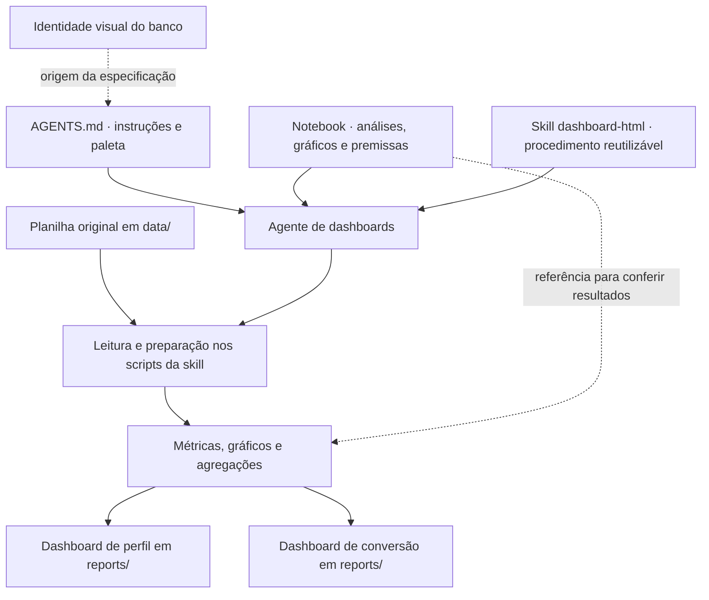

# Agente de Dashboard do Banco XPTOKW

O agente adapta a arquitetura do AI Data Analyst Agent para comunicar os resultados do estudo de campanha do Banco XPTOKW. O notebook é a fonte da verdade analítica. O `AGENTS.md` informa quais regras o agente deve seguir neste projeto e o gerador Python produz os painéis a partir da planilha.

## Fluxo



O agente consulta o notebook e as instruções para criar ou revisar as saídas. O comando de geração é independente da execução do notebook e pode ser repetido localmente com o ambiente Python do projeto.

## Arquivos e responsabilidades

| Arquivo | Responsabilidade |
| --- | --- |
| [`AGENTS.md`](../AGENTS.md) | Define a fonte analítica, a linguagem, as ressalvas, os caminhos de saída e os valores da paleta usados neste projeto. |
| [`.agents/skills/dashboard-html/SKILL.md`](../.agents/skills/dashboard-html/SKILL.md) | Descreve o procedimento geral de geração, conferência e organização visual. Inclui o uso de Chart.js, regras responsivas e referências aos scripts da skill. |
| [`notebooks/banco-analise-campanha.ipynb`](../notebooks/banco-analise-campanha.ipynb) | Define as perguntas de negócio, os cortes, as visualizações de referência e a interpretação dos resultados. |
| [`.agents/skills/dashboard-html/scripts/dados_dashboard.py`](../.agents/skills/dashboard-html/scripts/dados_dashboard.py) | Lê a aba `bank_marketing` com a segunda linha como cabeçalho e as colunas B a K. Valida a entrada, remove duplicatas exatas e calcula os recortes, o cruzamento idade × profissão, as probabilidades condicionais e os intervalos de confiança. |
| [`src/analise_IV.py`](../src/analise_IV.py) | Fornece as contagens por classe, as taxas de compra, o WoE e o IV. O gerador reaproveita a implementação já utilizada no notebook. |
| [`.agents/skills/dashboard-html/scripts/visualizacoes_dashboard.py`](../.agents/skills/dashboard-html/scripts/visualizacoes_dashboard.py) | Prepara agregados e configurações de Chart.js, tabelas equivalentes, mapa de calor em HTML e boxplots em SVG. |
| [`.agents/skills/dashboard-html/scripts/dashboard.js`](../.agents/skills/dashboard-html/scripts/dashboard.js) | Renderiza os gráficos, formata eixos e dicas de ferramenta e ajusta a criação e o redimensionamento em seções recolhíveis. |
| [`.agents/skills/dashboard-html/scripts/dashboard.css`](../.agents/skills/dashboard-html/scripts/dashboard.css) | Define a identidade visual, o grid adaptável e as dimensões dos contêineres de gráfico. |
| [`.agents/skills/dashboard-html/scripts/gerar_dashboards.py`](../.agents/skills/dashboard-html/scripts/gerar_dashboards.py) | Carrega e agrega a planilha, usa Chart.js para gráficos interativos, organiza as seções e grava os dois HTMLs em `reports/`. |
| [`reports/dashboard-perfil-clientes.html`](../reports/dashboard-perfil-clientes.html) | Apresenta a composição da base, o Pareto de profissões, a formação, o estado civil, as distribuições de idade e saldo e o relacionamento financeiro. |
| [`reports/dashboard-conversao-campanha.html`](../reports/dashboard-conversao-campanha.html) | Apresenta a taxa geral, os intervalos de confiança, as taxas por segmento, o mapa de calor por idade e profissão, as análises de ligações e os resultados de IV e WoE. |

## Identidade visual

O `AGENTS.md` informa diretamente as cores extraídas da [referência visual do banco](../images/identidade-visual-banco-xptokw.png). A implementação aplica `#171717` para texto e cabeçalho, `#C5A15A` para destaques e séries e `#F4F0E7` para o fundo. Os títulos usam fonte serifada e a interface usa fonte sem serifa.

## Rastreabilidade analítica

- **Perfil.** As seções 2 e 4 do notebook fundamentam as frequências, o Pareto e as distribuições. A formação desconhecida permanece explícita no cálculo dos limites possíveis para a proporção sem Ensino Superior.
- **Conversão e segmentos.** A seção 3 fundamenta as taxas por grupo, as faixas de idade e saldo e o mapa de calor. As tabelas preservam a diferença entre participação no total de compradores e taxa dentro do grupo.
- **Ligações.** A seção 5 fundamenta os grupos acumulados. O gerador monta cada série pelo limiar e pela condição, evitando depender da ordem de uma tabela classificada pela taxa. Os grupos acumulados se sobrepõem. As faixas 1, 2, 3, 4 e 5+ são disjuntas.
- **Incerteza.** O intervalo de Wilson de 95% é a referência principal. Clopper–Pearson e t de Student aparecem como comparações. A leitura populacional depende de premissas de amostragem.
- **IV e WoE.** O IV mede separação observada entre as classes e depende das categorias e dos cortes adotados. O WoE segue a convenção `ln(% Não Evento / % Evento)`. As contagens e taxas exibidas são observadas.

## Como regenerar os dashboards

Na raiz de `bank-marketing-analytics`, execute:

```powershell
uv sync
uv run python .agents/skills/dashboard-html/scripts/gerar_dashboards.py
```

Abra os dois arquivos em `reports/` no navegador. Os estilos, SVGs e dados agregados ficam incorporados no HTML. Gráficos Chart.js carregam a biblioteca por CDN e precisam de internet. Cada canvas tem rótulo acessível e texto ou tabela com os valores correspondentes.
